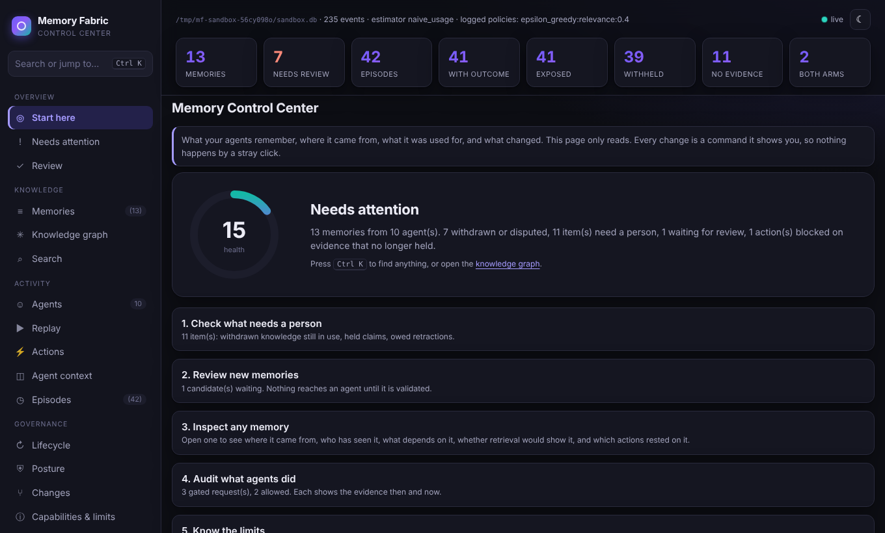
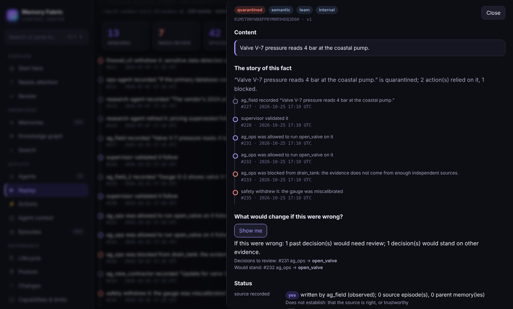
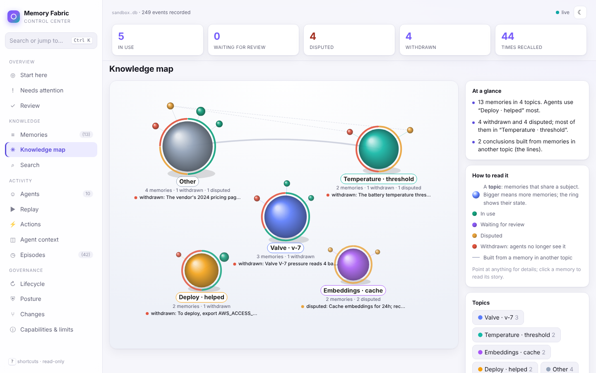

# Amberlog

**Trust infrastructure for collective intelligence.**

Amberlog is a governed knowledge and memory infrastructure layer for AI agents,
providing persistent context, verifiable provenance, correction propagation,
federation, and evidence-aware action control. It helps agents check where a
claim came from, withdraw incorrect knowledge, and verify evidence before acting.

[](https://github.com/crakashp2905-hub/amberlog/actions/workflows/ci.yml)


> **Status: alpha, 0.14.0 in development** (the last pinned baseline is 0.13.0, in the
> [release notes](docs/RELEASE_NOTES_0.13.0.md)). Not yet published under this name.
> What is stable and what is experimental: [STABILITY.md](STABILITY.md).
> The import, command and environment namespace changed. See
> [migration](docs/MIGRATING_TO_AMBERLOG.md) and
> [release readiness](docs/AMBERLOG_RELEASE_CHECKLIST.md).
> The repository rename is complete. Package-index publication remains pending
> name/account readiness and the release gates above.

---

## See it in sixty seconds

```bash
pip install .
amberlog tour
```

```
3. An operations agent asks to act on it
   ALLOWED: set_relief_valve, on evidence checked just now

4. The vendor says 12 bar was wrong
   shift-lead withdraws the fact, once, in one place
   recall now returns: nothing
   the plan built on it is now: contested

5. The same action, a minute later
   BLOCKED
   Blocked: "Pump P-14 relief valve is set to 12 bar." was withdrawn by shift-lead
   at 2026-10-25 15:08 UTC: vendor re-specified the setting as 10 bar.
   Re-certify with current evidence.
```

One fact, four agents, one correction, in an in-memory store: nothing is
written, downloaded or sent to a model. Then explore a store like it in the
dashboard, with a replay of everything that happened and the story of each
fact:

```bash
amberlog sandbox          # opens the Memory Control Center on localhost
```



| the story of one fact | the knowledge map |
|---|---|
|  |  |

`Ctrl K` finds anything; `?` lists the shortcuts.

## Why

A vector store gives an agent memory. It does not answer the questions that
matter once that memory is shared, long-lived or used to act:

- **Where did this come from?** A summary of a summary of a scraped web page
  looks exactly like a fact.
- **What happens when it turns out to be wrong?** The bad memory is already
  copied into other agents' stores and baked into their conclusions.
- **Should the agent act on it?** Being retrieved is not the same as being
  true, and a successful outcome does not prove the memory was right.

Amberlog is a memory layer built around those questions.

## What you get

| | |
|---|---|
| **Provenance and authority** | Every memory records its source, its author and how it was made. Trust is bound to the origin and carried through summaries, tool copies and other stores, so an injected note stays untrusted however many times it is rewritten. |
| **Correction that travels** | Withdraw a memory and it is withdrawn in every store it reached, including stores that received it second-hand. Conclusions built on it are re-checked; ones with independent support survive. |
| **Safe actions** | A protected tool runs only with a short-lived grant for that exact action, on evidence that is re-verified in the same transaction as the side effect. Expired grants, replays, changed targets and withdrawn evidence are refused. |
| **Poisoning defences** | Every claim is checked against what the store already knows: a corrected value stated again, a value far out of range, or a contradiction of an established fact is held for review and cannot be acted on. Injection and secret screens run at write time, disagreements are shown rather than ranked away, and a source caught injecting is withheld everywhere its memories travelled. |
| **Audit and erasure** | An append-only, hash-chained event log is the source of truth. Erasure destroys content and keeps the audit trail. |
| **Multi-tenant** | Tenant scope bound to the credential, seven separate permissions, or a physically separate store per tenant. |
| **Session handoff** | A short, governed summary of what a session established, for the sessions that follow. A later correction reaches it like any other memory. |
| **Runs anywhere** | Pure Python with no runtime dependencies. SQLite by default, PostgreSQL for several writers. MCP, HTTP, Python and LangChain. |

Amberlog is a governance layer. It works alongside your retriever and
your models; it does not replace them. It makes what your agents remember
accountable.

## Quick start

```bash
git clone https://github.com/crakashp2905-hub/amberlog.git
cd amberlog
pip install .
amberlog init ./memory        # a store, keys kept outside it, one agent, MCP config, doctor
```

Then, in Python: store, retrieve, inspect the evidence, correct, verify.

```python
from amberlog import Amberlog, correction
from amberlog.response import verify_recovery

fabric = Amberlog("memory.db", auto_activate=True)

wrong = fabric.remember("field-tech", "Pump P1 purge time is 10 s.", scope="team")
plan = fabric.derive("planner", "Restart P1 with a 10 s purge.", parents=[wrong], scope="team")

print([m.content for m in fabric.retrieve("assistant", "P1 purge time").exposed])
print(fabric.authority(plan).origins)               # ('field-tech',): where the plan came from

correction.apply(fabric, wrong, reason="the manual says 30 s", actor="shift-lead")
fabric.remember("manual", "Pump P1 requires a 30 s purge.", scope="team")

print([m.content for m in fabric.retrieve("assistant", "P1 purge time").exposed])
print(verify_recovery(fabric, wrong)["status"])     # contained: the plan was withdrawn too
fabric.close()
```

The ten-minute version, step by step: [docs/QUICKSTART.md](docs/QUICKSTART.md).
Recipes for sharing, gating tools, federating, tenants and handoffs:
[docs/COOKBOOK.md](docs/COOKBOOK.md).

## Connect your agent

**Claude Code, Claude Desktop, IDE assistants (MCP):** paste the configuration
`init` printed, or:

```json
{
  "mcpServers": {
    "amberlog": {
      "command": "amberlog",
      "args": ["--db", "/path/to/memory/store.db", "--keys", "/path/to/memory/keys",
               "mcp", "--agent", "my-assistant"]
    }
  }
}
```

The agent gets four tools: `recall`, `fetch`, `verify` (re-check before
acting) and `remember`. Every recalled memory comes with a one-line trust
summary (source, independent sources, age, corrections), and every refusal
with a sentence saying why and what to do. Its identity is fixed at launch. It
cannot read withdrawn memories, widen who sees a memory, or score its own work.

**Any other tool, any model:** `amberlog connect <tool> --write` sets up
Claude Code, Claude Desktop, Cursor, Windsurf, VS Code, Cline, Gemini CLI, Zed,
Codex or Continue; `AMBERLOG_MODEL=provider:model` picks the model for
every model-backed feature (Anthropic, OpenAI, Azure, Gemini, Groq, OpenRouter,
Ollama, vLLM and any OpenAI-compatible server):
[Any agent, any model](docs/guides/any-agent-any-model.md).

Framework guides: [Claude Code and Desktop](docs/guides/claude.md) ·
[LangGraph](docs/guides/langgraph.md) · [OpenAI Agents SDK](docs/guides/openai-agents.md) ·
[CrewAI](docs/guides/crewai.md).

**Agents in other processes or languages (HTTP):**

```bash
amberlog --db memory/store.db agent-api --agents-file agents.txt     # 127.0.0.1:8766
amberlog --db memory/store.db agent-api-issue --agents-file agents.txt --agent my-bot
curl -s -X POST http://127.0.0.1:8766/v1/recall \
  -H "Authorization: Bearer <credential>" -d '{"query": "pump fault E01"}'
```

**Python agents:** `sdk.agent(fabric, "my-bot")` for recall and remember;
`sdk.operator(fabric, actor="lead")` for review. LangChain, function-calling
tools and the Claude API adapter: [INTEGRATIONS.md](docs/INTEGRATIONS.md). A
complete agent loop, from retrieval to a gated, verified action:
[examples/reference_agent.py](examples/reference_agent.py).

## How it works

```
 agents ─► MCP / HTTP / SDK ─► identity + permissions ─► retrieval ─► action gate
                    │                                        │             │
                    ▼                                        ▼             ▼
          write path: injection and          exposure logged with   grant + evidence
          secret screens, firewall,          its probability        re-verified inside
          provenance, authority                     │               the transaction
                    │                               │                      │
                    └───────────►  append-only, hash-chained event log  ◄──┘
                                                │
              projections: memories, lineage, authority, influence graph
                                                │
           background manager: notices, retractions, retention, audit, checkpoints
                                                │
                       other stores (federation)  ·  CLI  ·  dashboard
```

- **The event log is the source of truth.** Every other piece of state can be
  rebuilt from it.
- **Memories have a lifecycle**: candidate → active → contested, quarantined,
  deprecated or deleted. Only active memories are shown by default.
- **Outcomes need a third-party verifier.** An agent cannot score itself.
- **Contradictions stay visible.** Nothing silently overwrites a disagreement.

The ideas in one page: [docs/CONCEPTS.md](docs/CONCEPTS.md). The design in
full: [ARCHITECTURE.md](ARCHITECTURE.md) and [SPEC.md](SPEC.md).

## How far it scales

One store sustains **130 memory operations a second** (p99 91 ms), and
saturates at 160. Agents that touch memory once every few seconds fit by the
hundred on one store. Past that, add stores and federate them. A correction
reaches every copy across chains of up to 16 hops, stars of 100 stores and
meshes with cycles. Details and sources: [docs/SCALE.md](docs/SCALE.md).

## Running it

```bash
docker build -t amberlog .
docker run -p 8765:8765 -v mf-data:/data -v mf-keys:/keys \
  -e AMBERLOG_TOKEN=<token> amberlog
```

- `amberlog doctor` says whether an installation's answers can be
  believed (exit 0 ok, 1 warn, 5 fail).
- `serve`, `mcp` and `agent-api` run the background manager by default. It
  delivers retractions and notices, applies retention, scans for
  contradictions and writes integrity checkpoints.
- `backup --with-keys` and `restore` cover the log, keys and config, checked
  against a manifest.
- `--log-format json` gives structured logs.
- The container uses the production cryptography profile: content is sealed
  only with AES-256-GCM from the maintained `cryptography` library
  ([CRYPTOGRAPHY.md](docs/CRYPTOGRAPHY.md)).

Deployment, capacity and upgrades: [DEPLOYMENT.md](DEPLOYMENT.md). Day-two
operations and incidents: [docs/OPERATIONS.md](docs/OPERATIONS.md),
[docs/RUNBOOKS.md](docs/RUNBOOKS.md).

## What it does not do

The full list is [docs/LIMITATIONS.md](docs/LIMITATIONS.md). The ones to
know before you start:

- **A plain false claim from a source that has never misbehaved is
  indistinguishable from truth** until something contradicts it.
  Contradiction surfacing and review narrow the window; nothing closes it.
- **The injection screens are text screens.** They catch common injection
  patterns, not every paraphrase. Origin-bound authority at the action gate
  is the backstop: untrusted content cannot authorise an action.
- **Tenancy within one store is an authorisation boundary**, not a physical
  one. Use a store per tenant (`tenancy.TenantRouter`) when that matters.
- **There has been no independent security review**
  ([brief](docs/INDEPENDENT_EVALUATION.md)).

## Documentation

| | |
|---|---|
| **Start** | [Quickstart](docs/QUICKSTART.md) · [Concepts](docs/CONCEPTS.md) · [Cookbook](docs/COOKBOOK.md) · [FAQ](docs/FAQ.md) · [Examples](examples/README.md) |
| **Reference** | [Python API](docs/API.md) · [CLI](docs/CLI.md) · [Integrations](docs/INTEGRATIONS.md) · [Federation protocol](docs/PROTOCOL.md) · [Schema](SPEC.md) |
| **Operate** | [Deployment](DEPLOYMENT.md) · [Operations](docs/OPERATIONS.md) · [Runbooks](docs/RUNBOOKS.md) · [Troubleshooting](docs/TROUBLESHOOTING.md) · [Migration](docs/MIGRATION.md) · [Scale](docs/SCALE.md) |
| **Trust** | [Security and threat model](SECURITY.md) · [Limitations](docs/LIMITATIONS.md) · [Stability](STABILITY.md) |
| **Project** | [Changelog](CHANGELOG.md) · [Release notes](docs/RELEASE_NOTES_0.13.0.md) · [Versioning](VERSIONING.md) · [Contributing](CONTRIBUTING.md) · [All docs](docs/README.md) |

## Development

Canonical implementation lives in `src/amberlog`. Install an editable checkout
before invoking the command directly from development scripts:

```bash
python -m pip install -e .
```

```bash
python tools/check.py           # regenerate docs, lint, type-check, doc tests, adversarial gate
python tools/check.py --full    # and the full suite, which needs no dependencies
```

**2242 tests** (see [the current baseline](docs/VALIDATION.md#current-baseline)),
a multi-store fault matrix and an adversarial release gate run
in CI on Linux, macOS and Windows. Read [AGENTS.md](AGENTS.md), the rules for
everyone who changes this repository, humans and AI agents alike, and
[CONTRIBUTING.md](CONTRIBUTING.md).

## License

Copyright © 2026 C R Akash Preetham. All rights reserved. Proprietary; see
[LICENSE](LICENSE).
